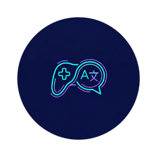
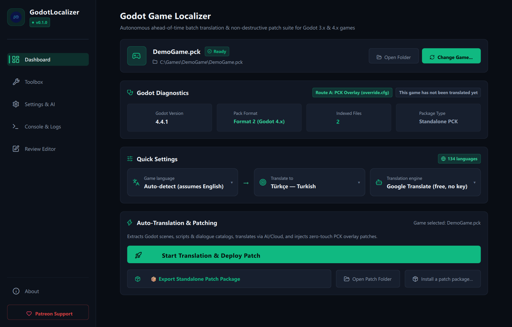
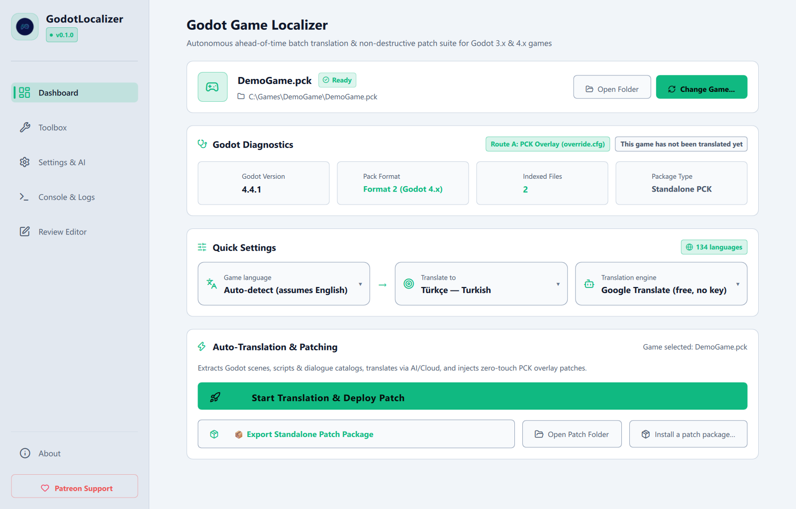
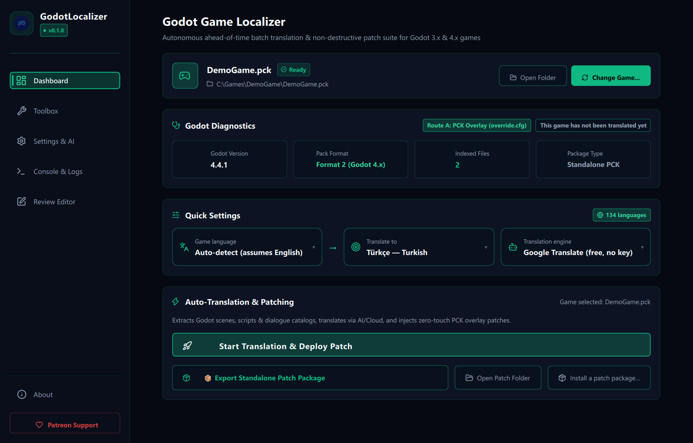
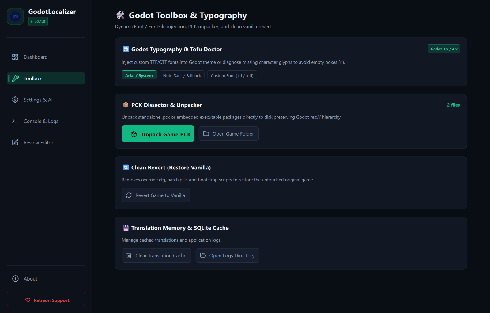
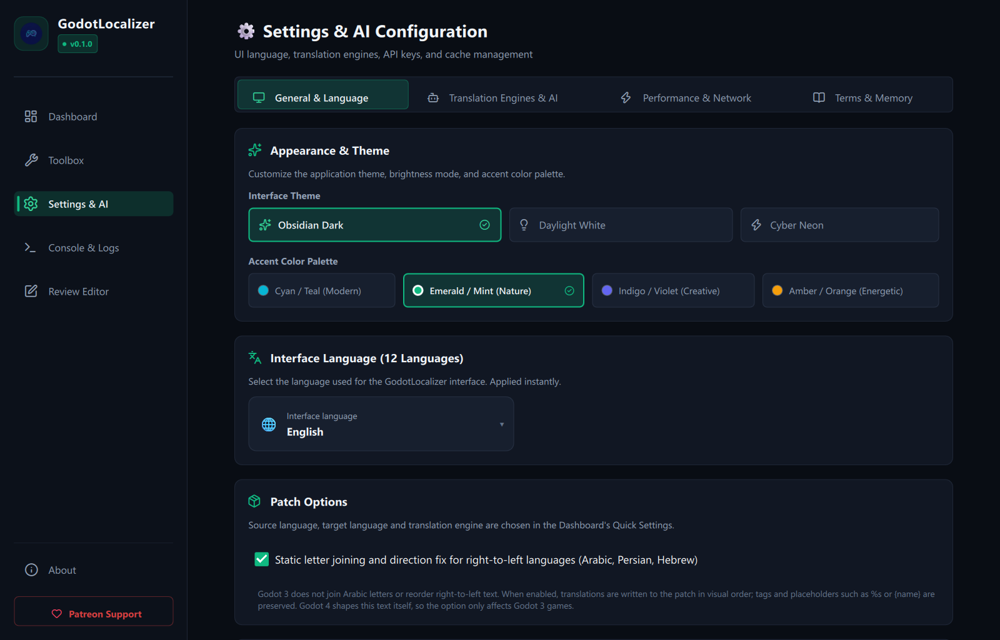

<div align="center">



# GodotLocalizer

### Translate any exported Godot game — without touching a single game file.

Drop in a game, pick your language, press **Translate**, then **Launch Game**.

[](LICENSE)


**12 interface languages · 3 themes · 8 translation engines · zero game files modified**

</div>

---

## ✨ What is GodotLocalizer?

**GodotLocalizer** is a desktop suite for **players, community translators and modders** who want to play Godot games in their own language — even when the developer never added localization.

It opens the game's `.pck` package (or the `.exe` it is embedded in), finds every piece of player-facing text, translates it, and ships the result as a small **overlay patch** that the game loads on startup. Your original game stays untouched, and one click puts everything back.

> Sister project of **RenLocalizer** (Ren'Py) and **UnityLocalizer** (Unity) — same philosophy, built for Godot.

---

## 📸 Screenshots

<div align="center">



 

 

</div>

---

## 🚀 Why you'll like it

| | |
|---|---|
| 🛡️ **Non-destructive** | Patches are applied as a PCK overlay + `override.cfg`. The game's files are never modified. *Revert Game to Vanilla* (Toolbox) restores the original state instantly. |
| 🧠 **Asks only when needed** | Pre-flight analysis inspects the game first. You're prompted for an encryption key, extra JSON fields or a decompiler **only if that game actually needs it**. |
| 🔎 **Finds text everywhere** | Translation tables, scenes, resources, GDScript — even **compiled** scripts and **binary** scenes. |
| ✅ **Syntax Guard** | `[color=red]`, `[wave amp=…]`, `%05d`, `{name}`, `[damage]` and other markup/variables are protected, so translated text never breaks the game. |
| 🔤 **Fixes missing-glyph "□" boxes** | Scans font coverage for your target language and ships a fallback font when needed. Handles RTL languages too. |
| 👀 **Human in the loop** | A built-in Review Editor, plus CSV sheet export/import for translators who prefer Excel or LibreOffice. |
| 📦 **Shareable patches** | Export a tiny patch `.zip` (no game files!) with one-click install/uninstall scripts. |
| ⚙️ **GUI *and* CLI** | Use the desktop app, or script everything for batch/server jobs. |

---

## 🎯 Supported games

- **Godot 3.x** and **Godot 4.x** (verified on 3.6.3, 4.4.1, 4.5.1, 4.6.2 and 4.7.2 against the real engine, headless)
- Standalone `.pck` files **and** executables with an embedded PCK: Windows `.exe` and Linux `.x86_64` (including Godot 4.3+ *Embed PCK*)
- **Encrypted** PCKs (AES-256) when you have the key
- PCK formats 2, 3 and 4

> ℹ️ GodotLocalizer works on **exported** games. It does not need the project source.

### 🧪 What is tested — and where we need your help

- **Verified:** the engine versions above, plus real exported Godot 4.6 games.
- **Not verified yet:** Godot 4.0–4.3 games, Linux and Steam Deck (the Linux build is experimental), macOS and Android packages.

This is an early release and every game is different. If you have a few Godot games installed, please try GodotLocalizer on them and tell us how it went — even a one-line *"worked / didn't work"* with the game name and Godot version (shown by `python run.py inspect`) is a big help, and every report makes the next release better. 💚

### ⚠️ Known limitations

- Games exported with a **custom Godot build** (a non-standard package signature, usually combined with encryption) cannot be read. GodotLocalizer tells you so instead of failing silently.
- **Encrypted** games need the key from you. GodotLocalizer does not break encryption or other protections.
- Compiled scripts from Godot **4.0–4.2** need GDRE Tools (optional, downloaded only after you confirm).
- "Sparse bundle" PCKs (a rare Godot 4.6+ feature) and macOS `.app` bundles are not supported yet.

---

## 🔍 What gets translated

<table>
<tr>
<td width="50%" valign="top">

**📚 Translation tables**
- `.csv`, `.po`, `.translation`
- `OptimizedTranslation` (smaz-compressed, hashed keys — rebuilt for you)

**🎬 Scenes & resources**
- Text scenes: `.tscn`, `.tres`
- Binary scenes & resources: `.scn`, `.res` (node-aware)
- UI properties such as `Label.text`, `Button.text`, `RichTextLabel` BBCode, popup items, tab titles

</td>
<td width="50%" valign="top">

**📜 Scripts**
- GDScript string literals
- **Compiled `.gdc` scripts** — read natively on Godot 4.3+, with optional GDRE Tools for older bytecode

**💬 Narrative plugins**
- **Dialogic** 1.x & 2.x
- **Dialogue Manager** (Nathan Hoad)

**🗂️ Game data**
- JSON data files, with smart detection of which fields hold player text
- External `lang_*` language packs (your language shows up in the game's own language menu)

</td>
</tr>
</table>

---

## 🌍 Translation engines

Bring your favorite — or mix and match. Results are cached in a local **SQLite** database, so re-runs and game updates only translate what's new.

| Free / no key | Bring your own key | Run locally |
|---|---|---|
| Google Translate | DeepL (Free & Pro) | Ollama (local LLM) |
| Bing (Edge) | OpenAI (GPT-4o) | LibreTranslate |
| | Google Gemini | |
| | DeepSeek | |

A **glossary** keeps character names and game terms consistent across the whole translation.

---

## 🖥️ The app

- **Three themes** — *Obsidian* (dark), *Daylight* (light) and *Cyber Neon*, each with accent presets
- **12 interface languages** — English, Türkçe, Deutsch, Español, Français, Italiano, Português (BR), Русский, 日本語, 한국어, 简体中文, فارسی
- **Dashboard** with live status: *Patched · tr*, or *The game was updated; rebuild the patch*
- **Review Editor** — search, filter by status (rejected / invalid / failed / edited / repaired / accepted), hand-edit rows, and **Save to game** without calling a translation engine again
- **Toolbox** — font doctor, PCK dissector (extract `res://` assets), one-click clean revert

---

## 📥 Installation

### Option 1 — Download a build (recommended)

Get the latest build from the [Releases page](../../releases):

- **Windows:** `GodotLocalizer-vX.Y.Z-windows-x64.zip` → unzip → run `GodotLocalizer.exe`. No Python needed.
- **Linux / Steam Deck (experimental):** `GodotLocalizer-vX.Y.Z-linux-x64.tar.gz` → extract → run `./GodotLocalizer`.

### Option 2 — Run from source

**Requirements:** Python 3.10 or newer (64-bit).

```powershell
git clone https://github.com/Lord0fTurk/GodotLocalizer.git
cd GodotLocalizer
python -m pip install -r requirements.txt
python run.py
```

Optional extras:

| Package / tool | Why |
|---|---|
| `pip install keyring` | Stores API keys and the PCK key in Windows Credential Manager / Keychain / Secret Service instead of `config.json` |
| `pip install arabic-reshaper python-bidi` | Right-to-left pre-shaping for **Godot 3** games (Arabic, Persian, Hebrew) |
| [GDRE Tools](https://github.com/GDRETools/gdsdecomp) | Only for compiled scripts of Godot 4.0–4.2. Settings → *GDRE Tools* can download it **after you confirm** file name, size and checksum — nothing is bundled |

---

## 🎮 Typical scenarios

### 1 · "I just want to play this game in my language"
Drop the game folder (or its `.exe` / `.pck`) onto the window → choose your language → **Translate** → **Launch Game**.
Nothing in the game is modified. *Revert Game to Vanilla* (Toolbox) undoes it.

### 2 · "I want a high-quality translation"
Translate, then open the **Review editor**. Fix rows by hand, or **Export sheet (CSV)** for a translator working in Excel/LibreOffice and **Import sheet** the result (UTF-8 with BOM, `;` / tab / `,` separators and formula-looking cells are handled). **Save to game** rebuilds the patch from your edits.

### 3 · "I want to share my translation"
**Export Standalone Patch Package** writes a small `.zip` — *patch only, no game files* — with `install` / `uninstall` scripts for Windows and Linux / Steam Deck. Recipients can run the script or use **Install a patch package…** in the app. Existing `override.cfg` settings are merged, and a warning appears if their game version differs.

### 4 · "The game got updated"
The dashboard tells you. Press **Translate** again — cached translations are reused, so only new strings cost anything.

### 5 · "I need to automate this"
Everything also runs without the GUI (from a source checkout, as below):

```powershell
python run.py inspect   "D:\Games\MyGame"
python run.py translate "D:\Games\MyGame" --lang tr --engine google --json-keys card_text
python run.py export    "D:\Games\MyGame" -o MyGame-tr.zip
python run.py install   MyGame-tr.zip "D:\Games\MyGame"
python run.py status    "D:\Games\MyGame"
python run.py revert    "D:\Games\MyGame"
```

| Exit code | Meaning |
|:-:|---|
| `0` | OK |
| `1` | Error |
| `2` | Usage error |
| `3` | Nothing to translate |
| `4` | Encryption key needed or wrong |

---

## 🧩 How it works

```text
 Game (.exe / .pck)
        │
        ▼
 ┌───────────────┐   ┌────────────────┐   ┌─────────────────┐   ┌──────────────────┐
 │  PCK Reader   │ → │   Harvesters   │ → │   Translators   │ → │  Overlay Patcher │
 │ (read-only,   │   │ scenes, tables,│   │ + Syntax Guard  │   │  PCK + override  │
 │  MD5-checked) │   │ scripts, JSON  │   │ + cache/glossary│   │  .cfg bootstrap  │
 └───────────────┘   └────────────────┘   └─────────────────┘   └──────────────────┘
                                                                         │
                                                                         ▼
                                              Game starts → bootstrap registers the translation
```

The default **Method A** writes `godotlocalizer_patch.pck`, a tiny bootstrap script and a merged `override.cfg` next to the game. An optional **Method B** rebuilds the PCK entirely (encrypted packs stay encrypted). Output files are namespaced, so a game's own `patch.pck` or `override.cfg` is never overwritten.

---

## 🔒 Privacy & safety

- Game files are **never modified**; patch files live beside them and are removable in one click.
- Nothing is downloaded without your explicit confirmation (the optional GDRE Tools download shows file name, size, source and SHA-256 first, and only accepts GitHub hosts).
- API keys can live in your OS credential store; keys are masked in logs.
- GodotLocalizer does **not** bypass game protections: for encrypted games you supply the key yourself.
- Text is sent only to the translation engine **you** choose — pick a local engine (Ollama / LibreTranslate) to keep everything on your machine.

---

## 🧪 Development

```powershell
python -m pytest tests -v     # test suite (byte-level fixtures + real-engine checks)
ruff check .                  # lint
```

The suite includes tests that export a project with a real Godot editor, patch it, and run it again. Set `GODOT4_BIN` / `GODOT3_BIN` to an editor build to enable them.

Architecture, binary layouts and contribution rules live in [AGENTS.md](AGENTS.md), [ANALYSIS.md](ANALYSIS.md) and [DESIGN.md](DESIGN.md). Release notes are in [CHANGELOG.md](CHANGELOG.md).

---

## 🤝 Contributing

Bug reports, game compatibility reports, new UI translations (`src/gui/i18n/*.json`) and pull requests are all welcome. If a game doesn't work, open an issue with the game name, Godot version (shown by `python run.py inspect`) and the log output.

---

## ⚖️ License & disclaimer

Released under the **GNU General Public License v3.0** — see [LICENSE](LICENSE).

GodotLocalizer is an independent community project and is not affiliated with the Godot Engine or its developers. Use it for games you own or have permission to translate, and respect the rights of game creators. A shared patch contains only your translated text — never distribute the game's own files.

<div align="center">

**Made with ❤️ for players who just want to understand the story.**

</div>
